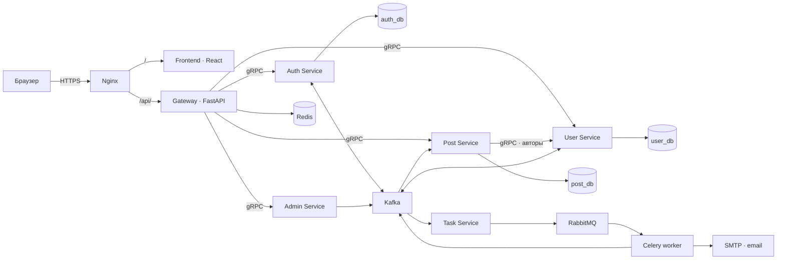

# Kload — микросервисный форум

Совместный пет-проект двух друзей: форум с регистрацией и подтверждением почты, профилями, публикациями и административными операциями. Backend написан на Python, frontend — на React и TypeScript.

Это центральный репозиторий проекта: Docker Compose, Nginx и документация. Исходники сервисов подключены как Git-подмодули; бизнес-логика находится в отдельных репозиториях.

## Навигация

- [Документация и все сервисы](docs/README.md)
- [Архитектура и диаграммы](docs/architecture.md)
- [Подготовка и запуск](docs/setup.md)
- [Сайт Kload](https://kload.ru) — адрес развёртывания; доступность зависит от работающего сервера и сертификатов.

## Сервисы

Описания открываются прямо в этом репозитории, даже без загрузки подмодулей. Ссылки на исходники ведут в репозитории авторов.

| Компонент | Назначение | Документация | Исходники |
| --- | --- | --- | --- |
| Auth Service | Регистрация, подтверждение почты, JWT | [README](docs/auth-service/README.md) | [Weit145/auth-service](https://github.com/Weit145/auth-service) |
| User Service | Профили и данные авторов | [README](docs/user-service/README.md) | [Weit145/user-service](https://github.com/Weit145/user-service) |
| Post Service | Создание, чтение, изменение и удаление постов | [README](docs/post-service/README.md) | [Weit145/post-service](https://github.com/Weit145/post-service) |
| Task Service | Письма и фоновые задачи через Celery | [README](docs/task-service/README.md) | [Weit145/task-service](https://github.com/Weit145/task-service) |
| Gateway | HTTP API, вызовы gRPC, ограничение частоты запросов | [README](docs/gateway/README.md) | [Weit145/gateway](https://github.com/Weit145/gateway) |
| Admin Service | Блокировка пользователей и удаление данных | [README](docs/admin-service/README.md) | [colosss/admin-service](https://github.com/colosss/admin-service) |
| Frontend | Пользовательский интерфейс форума | [README](docs/frontend/README.md) | [colosss/kload-frontend](https://github.com/colosss/kload-frontend) |
| Proto | Контракты Protocol Buffers и gRPC | [README](docs/proto/README.md) | [Weit145/proto-repo](https://github.com/Weit145/proto-repo) |

## Архитектура



[Подробные схемы запросов, регистрации и модерации](docs/architecture.md). GitHub отображает Mermaid непосредственно в Markdown; также доступна [исходная иллюстрация](docs/architecture.png).

## Стек

Python, FastAPI, gRPC, SQLAlchemy, Alembic, aiokafka, Celery; React, TypeScript, Vite, Axios; PostgreSQL, Redis, Kafka, RabbitMQ; Docker Compose, Nginx и Certbot.

Собственные PostgreSQL-базы есть у Auth, User и Post. Task обрабатывает события и ставит задачи в RabbitMQ, отдельный контейнер Celery выполняет их.

## Запуск

Понадобятся Git, Docker и Docker Compose v2. Общая последовательность:

```bash
git clone https://github.com/Weit145/microservices_site.git
cd microservices_site
git submodule update --init --recursive
# Подготовьте .env сервисов и сертификаты по инструкции ниже.
docker compose config --quiet
docker compose up -d --build
docker compose ps
```

**Перед запуском прочитайте [инструкцию](docs/setup.md).** Текущий Compose рассчитан на `kload.ru`: нужны `.env` и TLS-сертификаты, а HTTP-запросы перенаправляются на этот домен. При проверке загрузки обнаружены недоступные закреплённые коммиты подмодулей; подробности и диагностика приведены в инструкции. Простой `docker compose up` после клонирования не гарантирует готовый локальный сайт.

## Что открывать

| Ресурс | Адрес | Условие |
| --- | --- | --- |
| Форум | [https://kload.ru](https://kload.ru) | Работает развёртывание на домене |
| Swagger Gateway | [http://localhost:8000/docs](http://localhost:8000/docs) | Gateway и зависимости запущены локально |
| OpenAPI | [http://localhost:8000/openapi.json](http://localhost:8000/openapi.json) | Gateway запущен локально |

У внутренних gRPC-сервисов нет страниц для браузера. `http://auth-service:50051` и аналогичные адреса не являются веб-ссылками. [Все внутренние адреса и опубликованные порты](docs/setup.md#адреса-и-порты).

## Полезные команды

```bash
# Состояние и логи
docker compose ps
docker compose logs --tail=100 gateway auth-service

# Пересборка одного компонента
docker compose up -d --build frontend

# Миграции: пример для Auth
docker compose exec auth-service poetry run alembic upgrade head

# Чтение событий Kafka
docker compose exec kafka kafka-console-consumer \
  --bootstrap-server kafka:9092 --topic registration --from-beginning

# Остановка с сохранением томов баз данных
docker compose down
```

[Генерация gRPC-кода](docs/proto/README.md#генерация-python-кода). Обновление версий сервисов выполняется отдельно от правок документации: `git submodule update --init --recursive` загружает закреплённые версии, а `--remote` переключает их на версии удалённых веток.

## Авторы

[Weit145](https://github.com/Weit145) и [colosss](https://github.com/colosss). При изменении сервиса работайте в его репозитории; инфраструктуру и общую документацию меняйте здесь.
