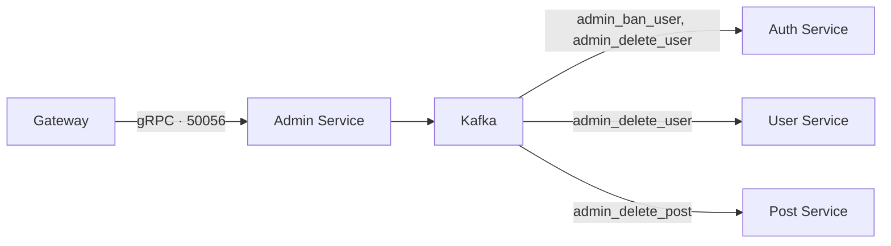

# Admin Service

[На главную](../../README.md) · [Все сервисы](../README.md) · [Архитектура](../architecture.md) · [Запуск](../setup.md) · [Репозиторий](https://github.com/colosss/admin-service)

Принимает административные gRPC-запросы от Gateway и публикует события модерации в Kafka. Собственная PostgreSQL-база для этого сервиса в Compose не предусмотрена.

## Существующие возможности

- Блокировка пользователя: событие `admin_ban_user`.
- Удаление пользователя: событие `admin_delete_user`.
- Удаление публикации: событие `admin_delete_post`.

## Связи



Изменения применяют сервисы-владельцы данных: [Auth](../auth-service/README.md), [User](../user-service/README.md), [Post](../post-service/README.md). Внешний HTTP API предоставляет [Gateway](../gateway/README.md).

## Настройка и доступ

Compose читает `admin-service/.env`; адрес Kafka — `KAFKA_BOOTSTRAP_SERVERS=kafka:9092`.

Внутренний адрес `admin-service:50056` использует gRPC. Порт на хост не опубликован, веб-страницы нет.

```bash
docker compose logs --tail=100 admin-service
```
