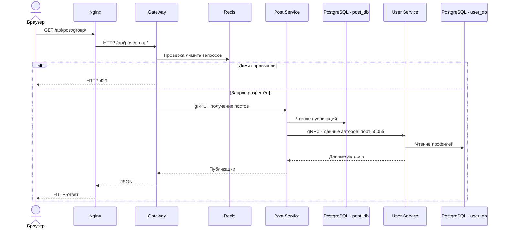
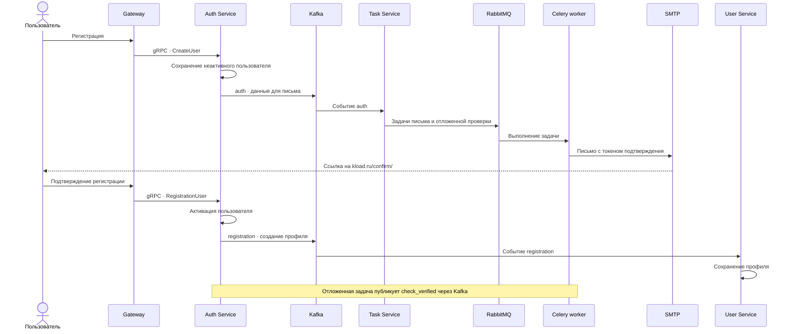
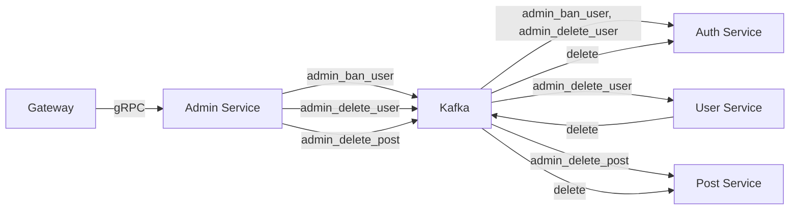

# Архитектура

[На главную](../README.md) · [Все сервисы](README.md) · [Запуск](setup.md)

Схемы описывают существующие связи платформы. Основной README показывает состав системы; здесь приведены отдельные сценарии. Mermaid отображается на GitHub, исходная картинка доступна [отдельно](architecture.png).

## Запрос публикаций

## Регистрация и подтверждение почты

Названия `auth` и `registration` отражают реализацию: Task читает `auth`, User читает `registration`. Создание профиля происходит асинхронно после подтверждения почты.

## Административные события

## Границы компонентов

HTTP API предоставляет Gateway. Nginx отдаёт frontend через `/` и проксирует `/api/` в Gateway. Backend-сервисы принимают gRPC внутри Docker-сети `microservices_net`; Task работает через брокеры сообщений. Redis используется Gateway для ограничения частоты запросов.

Auth, User и Post используют отдельные PostgreSQL-базы. Для Admin и Task отдельные базы в Compose не заданы. RabbitMQ передаёт задачи Celery; Kafka передаёт события между сервисами. Proto содержит контракты, отдельный контейнер для него не запускается.

Часть закреплённых коммитов недоступна в удалённых репозиториях. Связи сверены с Compose и доступными исходниками, но это не подтверждает совместимость всех закреплённых версий. [Ограничения запуска](setup.md#недоступные-коммиты-подмодулей).
