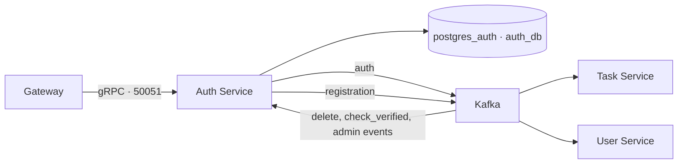

# Auth Service

[На главную](../../README.md) · [Все сервисы](../README.md) · [Архитектура](../architecture.md) · [Запуск](../setup.md) · [Репозиторий](https://github.com/Weit145/auth-service)

Регистрация, подтверждение email, вход, обновление и отзыв токенов. Сервис принимает gRPC-запросы от Gateway и хранит учётные записи в собственной базе PostgreSQL.

## Существующие возможности

- `CreateUser` — создание неактивной учётной записи и событие `auth` для письма.
- `RegistrationUser` — подтверждение почты и событие `registration` для создания профиля.
- `Authenticate`, `RefreshToken`, `LogOutUser` — вход и работа с токенами.
- `CurrentUser` — определение текущего пользователя.
- Обработка Kafka-событий `delete`, `check_verified`, `admin_delete_user`, `admin_ban_user`.

## Связи



[Gateway](../gateway/README.md) вызывает API, [Task](../task-service/README.md) отправляет письма, [User](../user-service/README.md) создаёт профили. [Admin](../admin-service/README.md) публикует события модерации.

## Настройка и доступ

Внутренний адрес: `auth-service:50051`, протокол gRPC. Порт на хост не опубликован; браузерного интерфейса нет.

Compose читает `auth-service/.env`. Основные настройки: `DB_URL`, `SECRET_KEY`, `ALGORITHM`, `KAFKA_BOOTSTRAP_SERVERS`. Дополнительно: `ACCESS_TOKEN_EXPIRE_MINUTES`, `ACCESS_TOKEN_EMAIL_MINUTES`, `ACCESS_TOKEN_REFRESH_DAY`.

В репозитории есть каталоги `app` и `src`; Compose запускает `app/main.py`. Папка `src` содержит отдельную структуру DDD, но схема работы выше соответствует запускаемому приложению.

```bash
docker compose logs --tail=100 auth-service
docker compose exec auth-service poetry run alembic upgrade head
```
