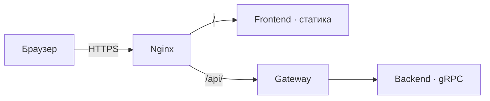

# Frontend

[На главную](../../README.md) · [Все сервисы](../README.md) · [Архитектура](../architecture.md) · [Запуск](../setup.md) · [Репозиторий](https://github.com/colosss/kload-frontend)

Клиент форума на React, TypeScript и Vite. Показывает публикации, профили и формы регистрации и входа. HTTP-запросы идут по относительному адресу /api через Nginx в Gateway.

## Существующие возможности

- Просмотр публикаций, отдельного поста и профилей.
- Регистрация, подтверждение почты, вход и выход.
- Создание и удаление публикаций.
- Хранение access-токена в памяти приложения и обновление через refresh cookie.
- Повтор запроса после успешного обновления токена при ответе 401.

## Связи



[Gateway](../gateway/README.md) предоставляет API, [Auth](../auth-service/README.md) управляет токенами. [Схемы запросов](../architecture.md).

## Запуск и адреса

Адрес развёртывания: [https://kload.ru](https://kload.ru). В Docker frontend слушает `frontend:80`, порт на хост отдельно не опубликован. Текущий внешний Nginx требует сертификаты домена: [инструкция](../setup.md#домен-и-сертификаты).

После загрузки подмодуля команды разработки выполняются в `frontend`:

```bash
npm ci
npm run dev
npm run build
```

Vite обычно открывает [http://localhost:5173](http://localhost:5173); фактический адрес выводится в терминале. В текущем `vite.config.ts` нет proxy для `/api`, поэтому dev-сервер сам по себе не подключает рабочий backend. Полная интеграция в существующей конфигурации выполняется через Nginx.

Пересборка из корня платформы:

```bash
docker compose up -d --build frontend
docker compose logs --tail=100 frontend nginx
```
