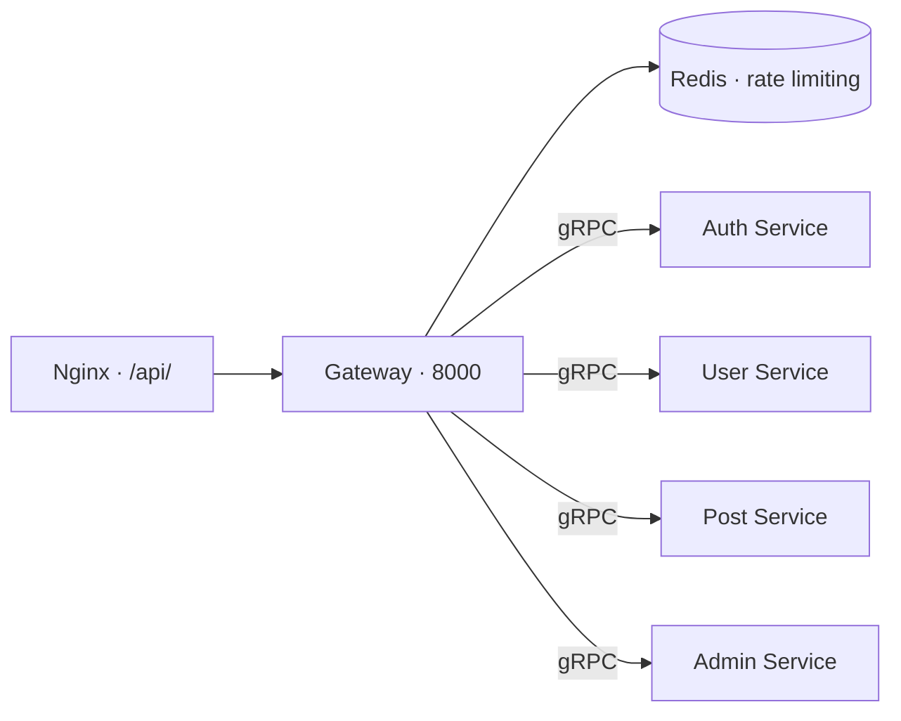

# Gateway

[На главную](../../README.md) · [Все сервисы](../README.md) · [Архитектура](../architecture.md) · [Запуск](../setup.md) · [Репозиторий](https://github.com/Weit145/gateway)

HTTP API платформы на FastAPI. Переводит запросы клиента в gRPC-вызовы Auth, User, Post и Admin, проверяет частоту запросов через Redis.

## Маршруты

| Группа | Назначение | Сервис |
| --- | --- | --- |
| `/api/auth/` | Регистрация, подтверждение почты, вход и токены | [Auth](../auth-service/README.md) |
| `/api/user/` | Чтение, обновление и удаление профиля | [User](../user-service/README.md) |
| `/api/post/` | Работа с публикациями | [Post](../post-service/README.md) |
| `/api/admin/` | Административные операции | [Admin](../admin-service/README.md) |

Точные методы, параметры и схемы ответов смотрите в Swagger работающего Gateway.

## Связи



## Настройка и доступ

Внутри сети: `gateway:8000`; опубликованный порт: `8000`.

- [Swagger](http://localhost:8000/docs)
- [OpenAPI JSON](http://localhost:8000/openapi.json)

Ссылки работают после локального запуска Gateway и зависимостей. Через домен Nginx проксирует только `/api/`; путь `/docs` не направляется в Gateway.

Compose передаёт `AUTH_HOST=auth-service` и `AUTH_PORT=50051`. В доступном конфиге Redis задаётся через `RD_URL`, по умолчанию `redis://redis:6379`. Контейнер использует Dockerfile из `gateway`, но контекст сборки — корень платформы.

```bash
docker compose logs --tail=100 gateway redis
curl --fail http://localhost:8000/openapi.json
```
