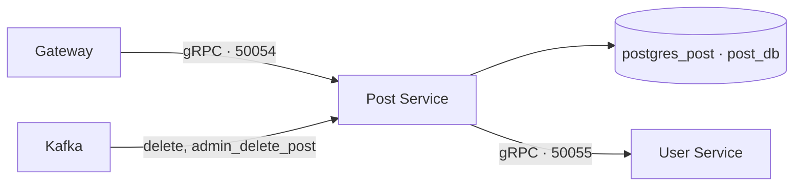

# Post Service

[На главную](../../README.md) · [Все сервисы](../README.md) · [Архитектура](../architecture.md) · [Запуск](../setup.md) · [Репозиторий](https://github.com/Weit145/post-service)

Управляет публикациями форума и хранит их в отдельной PostgreSQL-базе. При чтении получает данные авторов через внутренний gRPC API User Service.

## Существующие возможности

- Создание, получение, изменение и удаление публикаций.
- Получение списка постов с пагинацией и публикаций пользователя.
- Обогащение публикаций данными авторов из User Service.
- Обработка Kafka-событий `delete` и `admin_delete_post`.

## Связи



Связанные компоненты: [Gateway](../gateway/README.md), [User](../user-service/README.md), [Admin](../admin-service/README.md). [Последовательность запроса публикаций](../architecture.md#запрос-публикаций).

## Настройка и доступ

Compose читает `post-service/.env`: `DB_URL`, `KAFKA_BOOTSTRAP_SERVERS`. База — `postgres_post:5432/post_db`.

Внутренний адрес `post-service:50054` использует gRPC. Для HTTP-запросов используется Gateway; прямой страницы сервиса нет.

```bash
docker compose logs --tail=100 post-service
docker compose exec post-service poetry run alembic upgrade head
```
