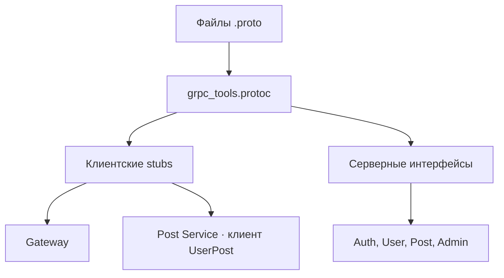

# Proto — контракты gRPC

[На главную](../../README.md) · [Все сервисы](../README.md) · [Архитектура](../architecture.md) · [Запуск](../setup.md) · [Репозиторий](https://github.com/Weit145/proto-repo)

Protocol Buffers описывают сообщения и методы взаимодействия Gateway и backend-сервисов. Репозиторий содержит .proto и сгенерированные файлы; отдельный контейнер для Proto не запускается.

## Контракты

| Файл | Назначение | Исходник |
| --- | --- | --- |
| `auth/auth.proto` | Регистрация, аутентификация и токены | [Открыть](https://github.com/Weit145/proto-repo/blob/main/auth/auth.proto) |
| `user/user.proto` | API профилей для Gateway | [Открыть](https://github.com/Weit145/proto-repo/blob/main/user/user.proto) |
| `user_post/user_post.proto` | Данные пользователей для Post | [Открыть](https://github.com/Weit145/proto-repo/blob/main/user_post/user_post.proto) |
| `post/post.proto` | API публикаций | [Открыть](https://github.com/Weit145/proto-repo/blob/main/post/post.proto) |
| `admin/admin.proto` | Административные операции | [Открыть](https://github.com/Weit145/proto-repo/blob/main/admin/admin.proto) |

Ссылки показывают текущую ветку `main` исходного репозитория; версия контракта в конкретном сервисе определяется его подмодулем.

## Связи



## Генерация Python-кода

Из каталога backend-сервиса с зависимостью `grpcio-tools` и загруженной папкой `proto`:

```bash
poetry run python -m grpc_tools.protoc \
  -I proto \
  --python_out=proto \
  --grpc_python_out=proto \
  proto/auth/auth.proto
```

Для другого контракта замените последний путь на нужный из таблицы. Генерация обновляет файлы в `proto`; учитывайте, что это отдельный Git-подмодуль.

[Gateway](../gateway/README.md), [Auth](../auth-service/README.md), [User](../user-service/README.md), [Post](../post-service/README.md) и [Admin](../admin-service/README.md) должны использовать совместимые контракты. [Проблема недоступного коммита auth-service/proto](../setup.md#недоступные-коммиты-подмодулей).
