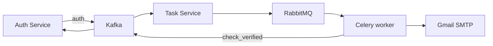

# Task Service

[На главную](../../README.md) · [Все сервисы](../README.md) · [Архитектура](../architecture.md) · [Запуск](../setup.md) · [Репозиторий](https://github.com/Weit145/task-service)

Фоновый обработчик событий для отправки писем подтверждения регистрации. Kafka доставляет события, RabbitMQ хранит задачи Celery, отдельный worker выполняет отправку через SMTP.

## Существующие возможности

- Чтение Kafka-топика `auth` и постановка задачи отправки письма.
- Формирование HTML-письма через Jinja2 и отправка через Gmail SMTP.
- Постановка отложенной проверки регистрации; задача публикует `check_verified`.
- Ссылка подтверждения в письме ведёт на `https://kload.ru/confirm/`.

## Связи



[Auth](../auth-service/README.md) отвечает за подтверждение токена; [Frontend](../frontend/README.md) показывает страницу подтверждения. [Сценарий регистрации](../architecture.md#регистрация-и-подтверждение-почты).

## Настройка и доступ

Compose читает `task-service/.env`: `CELERY_BROKER`, `KAFKA_BOOTSTRAP_SERVERS`, `GOOGLE_USER`, `GOOGLE_APP_PASSWORD`. Worker также должен получить настройки почты: [подробности](../setup.md#переменные-окружения).

Контейнеры `task-service` и `celery` собираются из одного каталога, но выполняют разные процессы. У Task нет HTTP/gRPC API, несмотря на `expose: 50052` в Compose. У worker нет веб-интерфейса.

```bash
docker compose logs --tail=100 task-service celery rabbitmq
```
