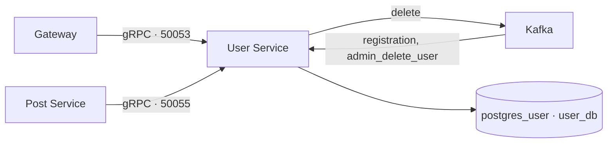

# User Service

[На главную](../../README.md) · [Все сервисы](../README.md) · [Архитектура](../architecture.md) · [Запуск](../setup.md) · [Репозиторий](https://github.com/Weit145/user-service)

Хранит профили пользователей. Получает событие подтверждённой регистрации от Auth и предоставляет два gRPC-интерфейса: для Gateway и для получения данных авторов публикаций.

## Существующие возможности

- Получение, обновление и самостоятельное удаление профиля.
- Создание профиля по Kafka-событию `registration`.
- Получение пользователей по имени, ID и списку ID для Post Service.
- Обработка `admin_delete_user`; публикация `delete` для связанных сервисов.

## Связи



Связанные компоненты: [Auth](../auth-service/README.md), [Gateway](../gateway/README.md), [Post](../post-service/README.md), [Admin](../admin-service/README.md).

## Настройка и доступ

Compose читает `user-service/.env`: `DB_URL`, `KAFKA_BOOTSTRAP_SERVERS`. База — `postgres_user:5432/user_db`.

Внутренние адреса: `user-service:50053` и `user-service:50055`. Второй порт открыт сервером в реализации, хотя отсутствует в `expose`. Оба интерфейса используют gRPC и не опубликованы на хост.

```bash
docker compose logs --tail=100 user-service
docker compose exec user-service poetry run alembic upgrade head
```
